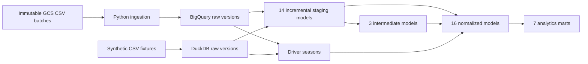

# Motorsports Data Pipeline

SQL transformations for Formula 1 and MotoGP analytics using **dbt, BigQuery, Google Cloud Storage, and Python**. The project turns heterogeneous racing datasets into typed staging tables, normalized entities, and seven analytics marts. A DuckDB demo runs the same 40-model graph locally with invented sample data and no cloud account.

Developed from a team project by **Marco Cheung and Pranav Pudu**, CS 333E, UT Austin, Spring 2026. Marco contributed the dbt staging/normalization work; Pranav contributed the final incremental conversion and ingestion notebook. This portfolio edition adds reproducibility and correctness improvements. See [contributions and provenance](docs/PROVENANCE.md) for the evidence and scope.

## Run the demo

Requires Python 3.12. From the repository root:

```bash
python3.12 -m venv .venv
source .venv/bin/activate
python -m pip install -r requirements.txt
dbt seed --profiles-dir profiles
dbt build --profiles-dir profiles --exclude resource_type:seed
python scripts/report.py
```

The demo creates `target/demo.duckdb`. All fixture names, racing results, and image annotations are synthetic. `dbt seed` resets local raw inputs; after reseeding an existing demo, use `dbt build --full-refresh --profiles-dir profiles --exclude resource_type:seed` to reset derived state as well.

Run the change scenarios and regression checks:

```bash
python -m pytest -q
# Or run the same end-to-end scenario and save its results:
python scripts/validate.py --report target/validation.json
```

Validation covers an initial load, insert/update MERGEs, replay, late arrivals, sponsor removal, changes to aggregate groups, stable identifiers, weather-only updates, and incremental/full-refresh parity for all 40 models. [Recorded validation](docs/VALIDATION.md) distinguishes local execution from BigQuery configuration checks.

## Architecture



Staging tables use keyed `MERGE` operations with a configurable seven-day ingestion-time lookback. Dimensions and marts rebuild from current staging state. This deliberately favors correct retractions and joins over an unmeasured claim that every layer needs incremental materialization. [Design decisions](docs/DESIGN.md) explain the tradeoffs and limitations.

## What can be queried?

| Mart | Question | Grain |
| --- | --- | --- |
| `constructor_performance_mrt` | How do constructors compare on points, wins, and finishes? | Constructor |
| `driver_season_participation_mrt` | Which seasons did each driver participate in? | Driver |
| `race_weather_impact_mrt` | What weather conditions accompanied each race's results? | Race |
| `motogp_constructor_wins_mrt` | How many winning race/class records belong to each constructor? | Season, constructor |
| `motogp_track_event_frequency_mrt` | Which circuits hosted the most events? | Track, country |
| `safety_trends_mrt` | How do supplied safety metrics vary by season? | Season |
| `image_sponsor_presence_mrt` | Which sponsor labels appear in image annotation metadata? | Sponsor |

The weather mart is descriptive; its historical name does not imply a causal estimate. The image mart consumes annotation metadata; this repository does not perform image inference or distribute images.

For example, the baseline synthetic race has two results worth **43 points** and two weather observations averaging **22°C**. Aggregating results and weather before joining keeps the total at 43 points. Joining individual results to individual weather observations would incorrectly produce 86.

```sql
select race_name, total_results, total_points, temperature
from demo_mrt.race_weather_impact_mrt
where raceId = 1001;
```

## Use BigQuery

The [BigQuery runbook](docs/BIGQUERY.md) covers authentication, raw schemas, immutable GCS batch ingestion, dataset isolation, configuration, and dbt commands. No historical datasets, credentials, or live cloud infrastructure are included. The current portfolio version has been executed locally; its BigQuery profile has been parsed without submitting cloud jobs.

## Repository guide

- `models/`: the 40-model graph and grain/relationship tests.
- `macros/`: adapter differences, ingestion-time lookback, and latest-version selection.
- `fixtures/`: 15 synthetic source tables with explicit types.
- `scripts/`: GCS ingestion, local report, and isolated validation scenarios.
- `tests/`: end-to-end data correctness and ingestion retry checks.
- `docs/`: design decisions, provenance, and validation evidence.

The [complete model lineage](docs/LINEAGE.md) is available without running the demo. To explore generated model documentation and lineage:

```bash
dbt docs generate --profiles-dir profiles
dbt docs serve --profiles-dir profiles
```
