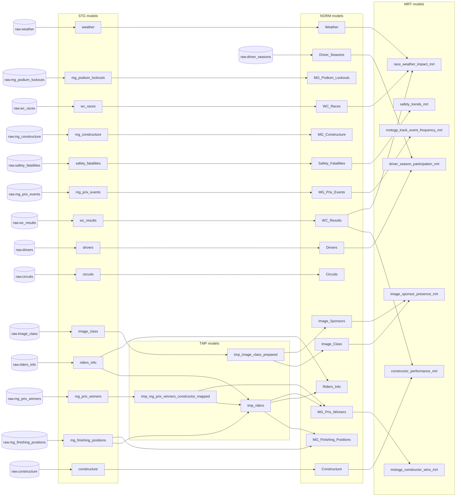

# Model lineage

Generated from the validated local dbt manifest. The same dependency graph is used for BigQuery. Raw inputs are sources, not additional models.

Regenerate dbt documentation after model changes to inspect the current graph: `dbt docs generate --profiles-dir profiles` followed by `dbt docs serve --profiles-dir profiles`.
